# Назначение и границы версии

Руководство для release `1.0.0`. Основной маршрут: поверхностные токи BEM →
T-матрица → аналитическое усреднение по всем ориентациям → локальная модель
по размеру. Здесь собраны выполненные исследования сходимости, формы,
интерполяции, невязки и сравнения с MBS-fast. Числа относятся к конкретным
сохранённым экспериментам; номер версии не означает универсальную точность 1%.

Для нового материала, формы и диапазона размеров отдельно проверяют сетку,
порядок T, точность оператора, решение системы и интерполяцию. Полная T для
ka=40 получена. Полная T для ka=100 и недельное время её построения этой
версией не подтверждены. Ряд новых ускорений остаётся экспериментальным.

Основной код — уравнение Мюллера второго рода, BDM1 на острых частицах,
FMM/FFT и смешанная точность с FP64-проверкой. Гладкая сфера использует P2.
Старый PMCHWT/RWG — отдельный тракт; его эксперимент `muller2` не заменяет
BDM1-решатель. Историческое руководство сохранено в
[архиве фиксированной ориентации](docs/legacy_fixed_orientation_manual.md).

# Физические параметры и одинаковая геометрия

Размер задаётся через радиус равновеликой сферы $a$:

$$ka=k_0a,\qquad k_0=2\pi/\lambda,\qquad a=ka\lambda/(2\pi).$$

Внутри задачи геометрия нормирована на $a=1$. Длина волны в микрометрах
задаёт перевод в физические единицы. При дисперсии изменение длины волны
требует также изменения показателя преломления; это уже другая семья T.
Используется временная зависимость $\exp(-i\omega t)$ и пассивное поглощение
$m=n+i\kappa$, $\kappa\geq0$.

Для правильной шестиугольной призмы `prism-aspect` — отношение высоты $H$
к ширине между противоположными **гранями** $D_f$, не к диаметру по вершинам.
Пусть $\eta=H/D_f$. Тогда

$$V=\frac{\sqrt3}{2}D_f^2H,\quad
\frac{D_f}{a}=\left(\frac{8\pi}{3\sqrt3\eta}\right)^{1/3},\quad
\frac{R}{a}=\frac{D_f}{a}\sqrt{\frac13+\frac{\eta^2}{4}},$$

где $R$ — радиус описанной сферы. Он существенно влияет на необходимый $L$.
Диаметр по вершинам $D_v=2D_f/\sqrt3$; поэтому $H/D_v=\eta\sqrt3/2$.

Текущий столбик: $m=1.3116$, $\lambda=0.532$ мкм, $H/D_f=1/0.7=10/7$.
Для него $R/a\approx1.379127$, а параметр MBS по диаметру вершин равен
$H/D_v\approx1.2371791483$. При ka=40 радиус равновеликой сферы около
3.387 мкм. Старые мультиразмерные данные ka=10…12 имеют **$H/D_f=1$**;
их нельзя смешивать с этим столбиком.

# Что представляет собой T-матрица

Регулярные векторные сферические волны задают падающее поле; исходящие —
рассеянное. Для коэффициентов $a$ и $b$ выполняется $b=Ta$.
При максимальном порядке $L$ в каждой поляризации $L(L+2)$ мод, всего

$$q=2L(L+2),\qquad T\in\mathbb C^{q\times q}.$$

Столбец отвечает одной падающей моде, строка — одной исходящей. Обе
поляризации нужны: симметрия связывает определённые моды и сектора, но не
позволяет произвольно удалить половину электрических/магнитных решений.

| L | Строк и столбцов q | Хранение complex128, без заголовка |
|---:|---:|---:|
| 20 | 880 | 11.82 MiB |
| 24 | 1248 | 23.77 MiB |
| 58 | 6960 | 739.16 MiB |
| 64 | 8448 | 1089 MiB |
| 68 | 9520 | 1382.91 MiB |

Память T растёт как $L^4$. Время построения зависит также от сетки, числа
итераций, симметрий, повторного использования подпространств и стоимости
дальнего поля. Сокращение числа мод на 18% не доказывает такое же сокращение
полного времени.

Усечение должно выбирать индексы $l\leq L_{new}$ **в обеих поляризациях и
по обеим осям**. Обычный срез `T[:q_new, :q_new]` при раздельном хранении
поляризаций неверен. Используйте индексирование из `study_tmatrix_cutoff.py`.

## Аналитическое усреднение

`tmatrix_so3_mstm.py` свёртывает произведения элементов T с угловыми
коэффициентами и вычисляет усреднённую матрицу Мюллера. Интегрирование по
SO(3) аналитическое: `Euler_quadrature_nodes = 0`. Сетка `ntheta` задаёт
**угол рассеяния выходного графика**, а не ориентации частицы.

Угловая сетка проекции дальнего поля при построении T — другая численная
операция. Её сходимость проверяется отдельно. Аналитическое усреднение
устраняет ошибку ориентационной квадратуры, но сохраняет ошибки самой T.

В принятой нормировке безразмерных токов и сферических волн:

$$C_{sca}=\frac{2\pi}{(ka)^2}\|T\|_F^2,\qquad
C_{ext}=-\frac{2\pi}{(ka)^2}\operatorname{Re}\operatorname{tr}T.$$

Для физических сечений в мкм² результат умножается на $a^2$.
Сравнивая матрицы Мюллера, проверяйте Stokes-конвенцию и единицы;
дополнительная подгонка масштаба по переднему пику недопустима.

## Вращения и зеркала

Для правильной центрированной призмы используется C6 и зеркальная
симметрия: горизонтальное отражение, вертикальные отражения и связанные
сектора D6h. `c6-pack` кодирует допустимые моды в фазовые правые части,
`mirror-pack` использует горизонтальную чётность. `vertical-preconditioner`
согласует обратный предобуславливатель с вертикальными отражениями.
Полярные и аксиальные компоненты токов при отражении имеют разные знаки.

Проверяется действие оператора, упаковка/распаковка, дальнее поле и полная
невязка. Невязка закодированной правой части не является отдельным
измерением невязки каждого восстановленного столбца. В отчётах ka=40 это
различие сохранено. Для OBJ без точной симметрии упаковка неприменима.

# Установка и первый расчёт

Нужны Linux, GCC, CUDA для GPU-ветки, BLAS/LAPACK, FFTW, Python 3 с NumPy,
SciPy и Matplotlib. Точные библиотеки и цели сборки перечислены в Makefile.
Для аналитического усреднения нужен gfortran и соответствующий нативный
инструмент. CPU FFT требует FP64-библиотеку FFTW (`libfftw3-double3` в
Ubuntu); путь к нестандартной установке задаёт `BEM_CPU_FFTW_LIBRARY`. Версия компилятора CUDA должна быть совместима с host GCC.

```bash
python3 -m pip install numpy scipy matplotlib psutil
make muller-fp32 CXX=g++-12 CUDA_HOME=/usr -j2
make bin/muller_tmatrix_fmm_server CXX=g++-12 CUDA_HOME=/usr -j2
make bin/tmatrix_so3_mstm bin/tmatrix_so3_mstm_fp32
```

Небольшой проверочный пример, не эталон точности 1%:

```bash
OMP_NUM_THREADS=2 OPENBLAS_NUM_THREADS=1 \
python3 scripts/build_fmm_tmatrix.py \
  --shape prism --ref 2 --ka 3 --ri 1.3116 \
  --prism-aspect 1.4285714285714286 --wavelength 0.532 \
  --order 10 --tol 2e-6 --max-iters 1000 \
  --c6-pack --mirror-pack --so3-precision fp64 --ntheta 181 \
  --out runs/example_ka3
```

Для повторного усреднения готовой T без BEM:

```bash
python3 scripts/tmatrix_so3_mstm.py \
  --tmatrix runs/example_ka3/tmatrix.npy --order 10 \
  --ntheta 1801 --cyclic-order 6 --precision fp64 --threads 2 \
  --out runs/example_ka3/so3_fine.json
```

`summary.json` должен сообщать о завершённости, размерности T, физических
параметрах и проверках. Наличие файла `tmatrix.npy` само по себе не означает,
что все его столбцы рассчитаны. Нельзя усреднять частичную T как готовую.

Для прежнего фиксированного падения сохраняется команда:

```bash
./bem run --shape prism --ka 25 --ri 1.3
```

Её профили описаны в [quality_profiles](docs/quality_profiles.md).
Это отдельный маршрут; один расчёт плоской волны не строит T.

# Большая T: запуск, память и продолжение

`run_large_tmatrix.py` фиксирует копию worker, параметры, среду и входные
скрипты. Пример подготовки ka=40, а не автоматически доказанный оптимум:

```bash
python3 scripts/run_large_tmatrix.py \
  --out runs/ka40_v1 --ka 40 --ref 6 --order 64 \
  --ri 1.3116 --wavelength 0.532 --prism-aspect 1.4285714285714286 \
  --tol 2e-6 --restart 64 --max-iters 1000 \
  --sector-gmres --sector-recycle-rank 16 \
  --vertical-preconditioner --inner-local-coordinates \
  --gpu-assembly --gpu-host-correction --incident-prefetch \
  --cutoff-orders 54 56 58 60 62 64 --prepare-only
```

После изучения плана повторяют ту же команду без `prepare-only`.
Точные рабочие FFT-параметры из исследования находятся в переносимом
`reference/v1.0.0/research/data.json`, разделе `ka40_completed.parameters`.
Не следует включать все экспериментальные опции одновременно.

`hybrid-cpu` перекрывает независимые пакеты и CPU FP64-проверки. Он требует
sector GMRES, дополнительной RAM и измерения полной стоимости. Вынос
локальных поправок в RAM (`gpu-host-correction`) помогает вместить сетку,
но меняет баланс PCIe/CPU/GPU. AVX512 не гарантирует ускорение всей задачи.

В каталоге сохраняются готовые столбцы, квитанции пакетов, описание
оператора, контрольные суммы, прогресс и итоговая сводка. При обычном
возобновлении сохраняют каталог и физические параметры. Смена решателя
проводится через проверяемый `solver-restart-from` и
`solver-restart-proof`; изменение геометрии или материала не является
совместимым возобновлением. Живое пространство recycling в RAM может
потребовать повторного обучения после перезапуска.

Диск включает T, чекпоинты, операторные кэши, поля, входы и временные копии.
Размер одного `tmatrix.npy` — лишь часть потребности. Перед большим запуском
проверяют свободный диск, RAM и VRAM, затем измеряют несколько настоящих
пакетов. Для разных размеров хранение всех поверхностных токов гораздо
дороже архива одних усреднённых матриц Мюллера.

# Как проверяется точность 1%

Основная опубликованная угловая метрика:

$$\epsilon_M=\max_{\theta,i,j}
\frac{|M_{ij}^{test}(\theta)-M_{ij}^{ref}(\theta)|}{M_{11}^{ref}(\theta)}.$$

Она охватывает все 16 элементов на указанной сетке углов и использует одну
физически понятную нормировку. Это **не** относительная ошибка каждого
малого $M_{ij}$. Вблизи его нуля такая относительная ошибка неустойчива;
на слабых элементах она может превышать 1% при выполнении критерия выше.
Сечения $C_{sca}$ и $C_{ext}$ сравниваются отдельно относительно эталона.

Пять независимых проверок:

1. Сетка: сравнение `ref` и `ref+1` при достаточном L.
2. Порядок: последовательные усечения T, затем контроль большего эталонного L.
3. Оператор: квадратура, Duffy, ближняя зона, FMM/FFT и FP64.
4. Решение: истинная невязка и устойчивость конечных элементов Мюллера.
5. Мультиразмер: новые прямые T в точках, не использованных для обучения.

Каждая проверка с допуском 1% по отдельности не даёт суммарный бюджет 1%.
Для итоговой цели нужен запас и прямой контроль конечного результата.
Сравнение на дискретных углах также не является строгой оценкой между ними.

# Зависимость L от размера

Историческая серия: призма $H/D_f=1$, $m=1.3$; минимум по изученному
критерию относительно конечного эталона:

| ka | ref | Эталонный L | Минимальный L |
|---:|---:|---:|---:|
| 3 | 3 | 9 | 6 |
| 6 | 3 | 18 | 10 |
| 12 | 4 | 28 | 17 |
| 20 | 5 | 44 | 27 |

Локальная линейная аппроксимация $L\approx1.22667ka+2.42667$ описывает
этот набор ka=3…20. Она не определяет L для ka=100 или для другой формы.

Текущая серия $m=1.3116$, $H/D_f=10/7$, критерий включает все 16 элементов
и оба сечения. После устойчивого прохождения добавлен запас два порядка:

| ka | ref | Эталон L | Минимум | L с запасом | Ошибка с запасом |
|---:|---:|---:|---:|---:|---:|
| 5 | 2 | 14 | 9 | 11 | 0.0363% |
| 10 | 3 | 20 | 16 | 18 | 0.0577% |
| 40 | 6 | 64 | 56 | 58 | 0.2408% |

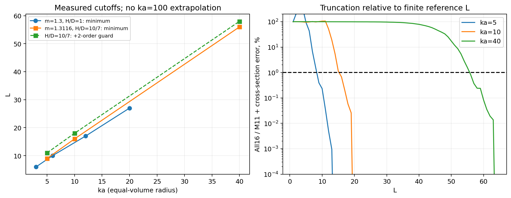

Для ka=40 переход 64→58 даёт 8448→6960 мод: на 17.61% меньше мод и
на 32.12% меньше хранения T. Это исследование **усечения**: хвост выше
L=64 и независимая ошибка поверхности им не измерены.
`select_tmatrix_order.py` проверяет источник, хеш T, последовательность
порядков, параметры и запас. Передать его заключение на другую задачу
через `order-study` без совпадения параметров нельзя.

## Достройка порядка через взаимность

`tmatrix_reciprocal_extension.py` сохраняет прежний квадрат T и непосредственно
вычисленные новые входящие столбцы. Недостающий блок новых исходящих/старых
входящих мод восстанавливается взаимностью: знаковая перестановка $m\to-m$
и **транспонирование**, без комплексного сопряжения.

Ретроспективная проверка на полных сохранённых T дала максимальную ошибку:
ka=5, 7→14 — 0.08697%; ka=10, 14→20 — 0.05271%; ka=40, 54→64 —
0.001505%. При ka=40, 58→64 — 0.0001303%. Все девять случаев прошли 0.1%.
Это восстановление уже известного блока, не новый BEM-расчёт выше L=64.
Измеренного ускорения настоящей достройки пока нет. Разные сетки проекции
старой и новой T потребуют дополнительного контроля.

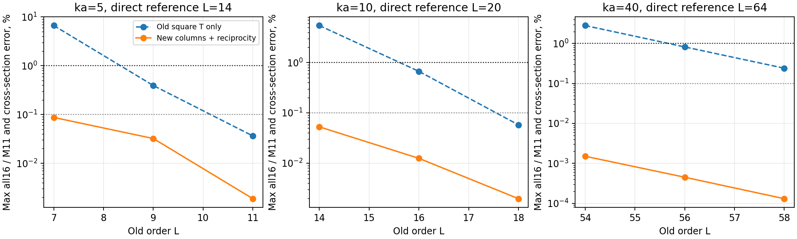

# Влияние вытянутости и сплюснутости

Шесть случаев с $m=1.3116$. Минимальный L ниже относится к усечению;
столбец сетки — отдельное сравнение поверхности.

| ka | H/Df | R/a | Минимальный L | Сравнение ref | Ошибка сетки |
|---:|---:|---:|---:|:---:|---:|
| 2 | 0.2 | 1.6945 | 6 | 2→3 | 0.3258% |
| 2 | 1 | 1.2916 | 4 | 2→3 | 0.3177% |
| 2 | 5 | 2.5376 | 7 | 2→3 | 0.0926% |
| 5 | 0.2 | 1.6945 | 11 | 3→4 | **1.1319%** |
| 5 | 1 | 1.2916 | 9 | 3→4 | 0.1489% |
| 5 | 5 | 2.5376 | 16 | 2→3 | 0.5350% |

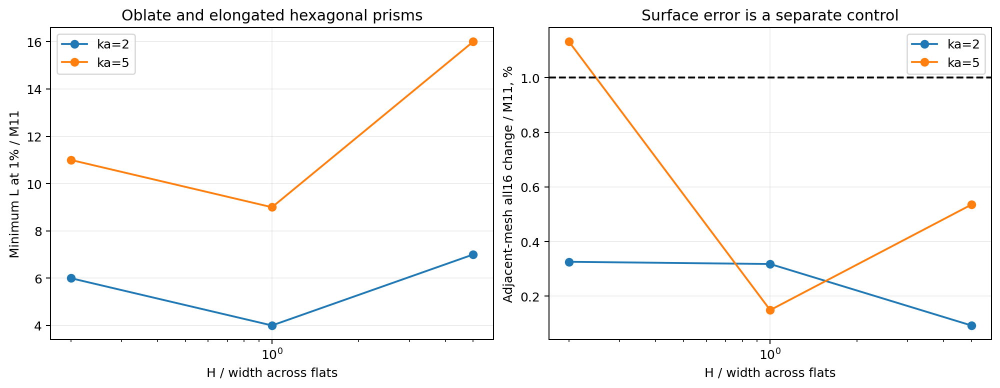

Вытянутому объекту нужен больший порядок при том же равновеликом ka.
Сплюснутая призма ka=5 на изученной сетке **не прошла 1%**. Малый хвост T
не исправляет эту ошибку. Для малых проверенных порядков аналитическое
SO(3) совпало с независимым ориентационным контролем на уровне примерно
$10^{-14}$…$2\cdot10^{-13}$; это проверка усреднения, а не поверхности.

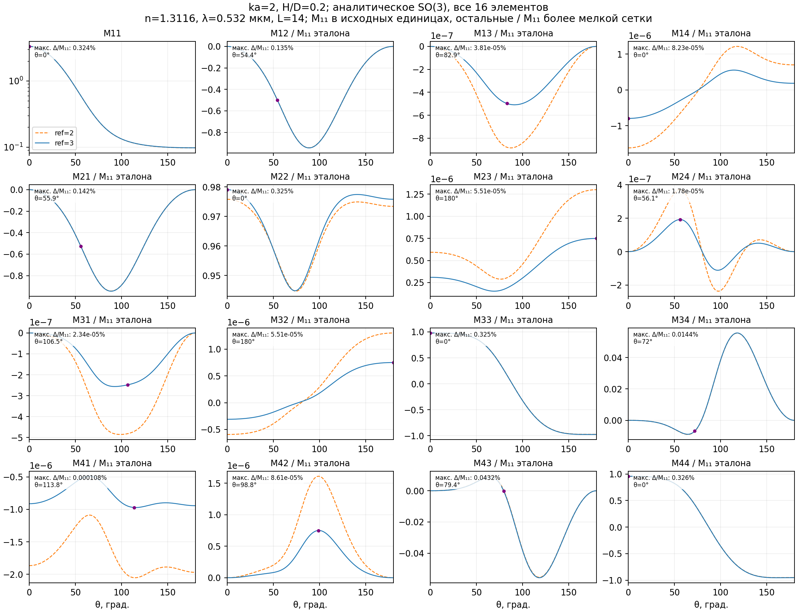

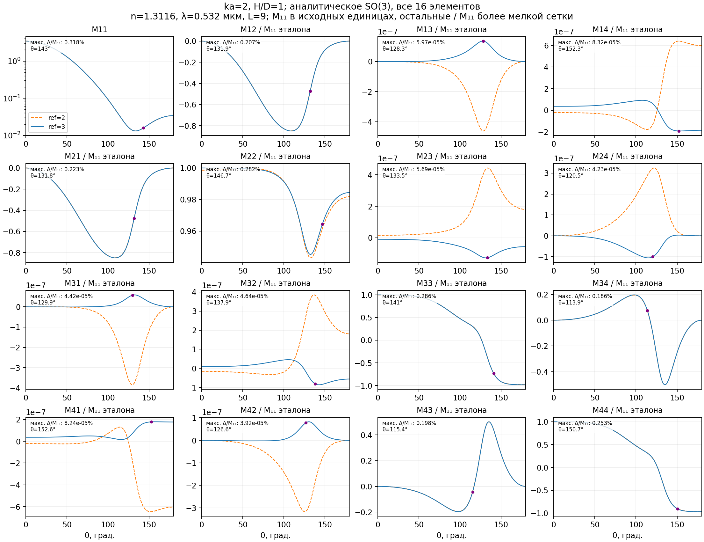

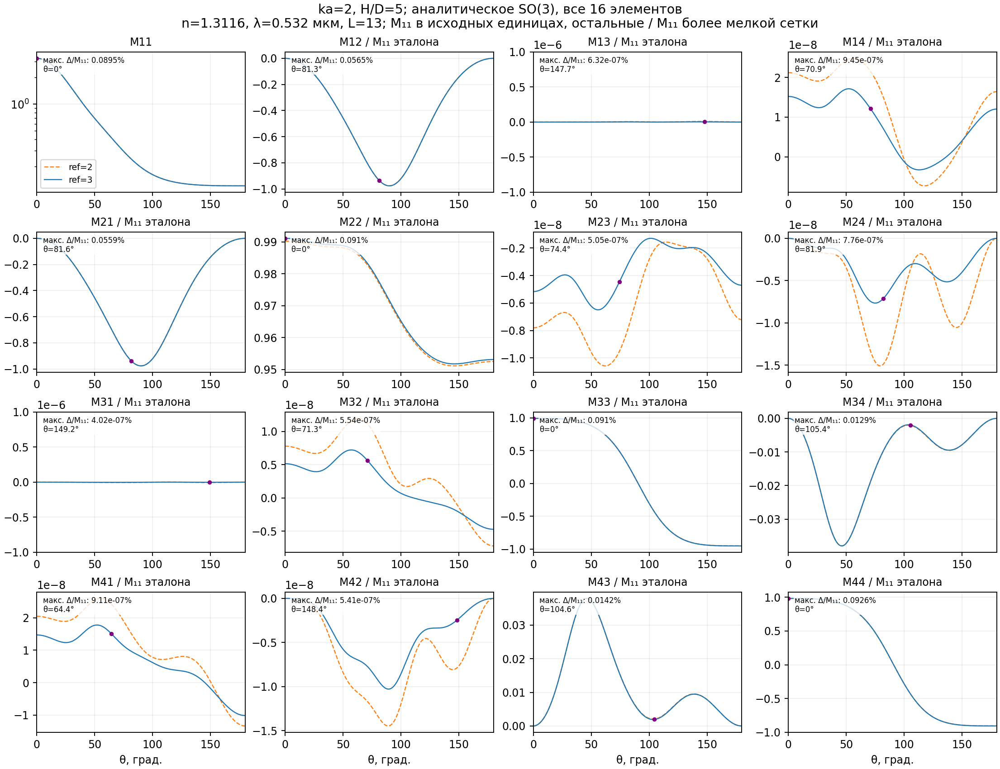

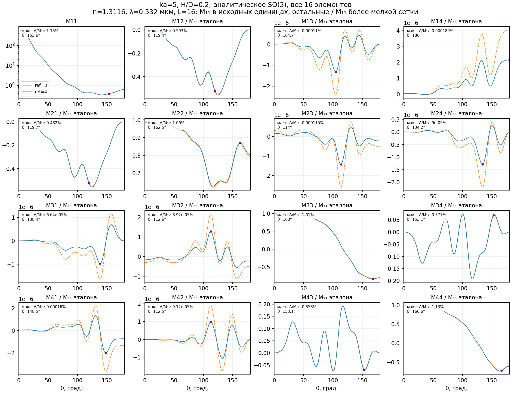

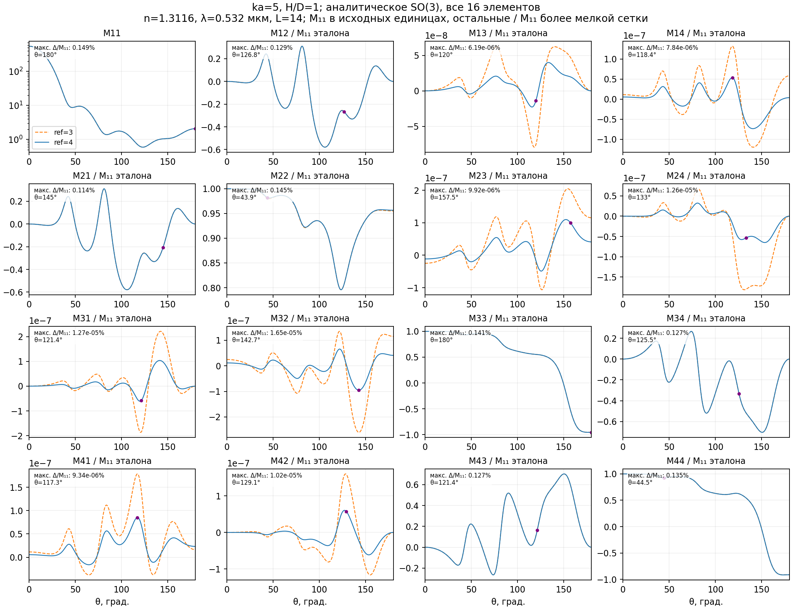

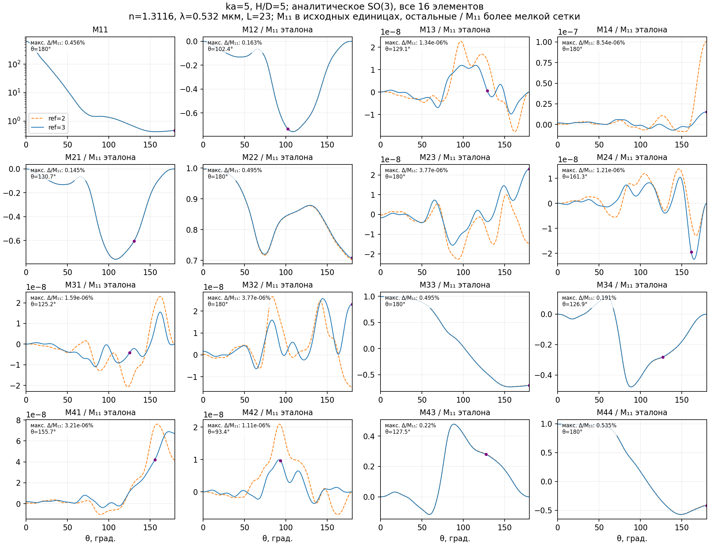

Дополнительная серия $H/D_f=1$, $m=1.3116$: при ka=10, L=21 сравнение
ref4→5 дало 0.2366%, а при ka=20, L=34 — **5.5170%**. При этом вклад
последних четырёх порядков оценён всего в 0.1027% и 0.0750%. Поэтому
увеличение L само по себе не решает проблему сеточной сходимости.

# Мультиразмерная T: где возникает экономия

При фиксированной форме и материале геометрические структуры и кэши можно
переиспользовать, но оператор зависит от ka. Одна T при ka=40 не определяет
T соседних размеров без дополнительной информации о частотной зависимости.

Проверенный маршрут: несколько прямых опорных T → рациональная модель
элементов T → независимые прямые контрольные размеры → аналитическое SO(3)
для плотной сетки. Интерполируется **комплексная T**, затем вычисляются
квадратичные величины; интерполяция одной M11 не восстанавливает полную T.

Обязательны одинаковые геометрия, материал, базис, порядок, проекция и
соглашения. Обучающие и контрольные размеры не пересекаются. При провале
интервал сужается или добавляются опоры. Экстраполяция вне проверенного
интервала запрещена политикой локальной модели.

## Выполненная серия ka=10…12

Параметры: $m=1.3116$, $\lambda=0.532$ мкм, **$H/D_f=1$**, ref4, L=24.
Девять опор ka=10, 10.25, …, 12; четыре независимых прямых решения:
10.125, 10.875, 11.125, 11.875.

- Максимум ошибки всех 16 элементов относительно M11: **0.38556%**.
- Максимальная относительная ошибка T по Фробениусу: **0.17689%**.
- Относительная ошибка отдельных слабых активных элементов доходила до
  **14.65%**; она не равна основной нормировке.
- Контроли сетки на концах дали около 0.2366% и 0.5314%.
- Вычисление **201 размера готовой моделью и усреднение заняли 88.30 с**,
  без новых BEM-решений. Построение опор и контролей в эти 88.30 с не входит.
- Запрошенный более широкий диапазон этой серией не был охвачен.

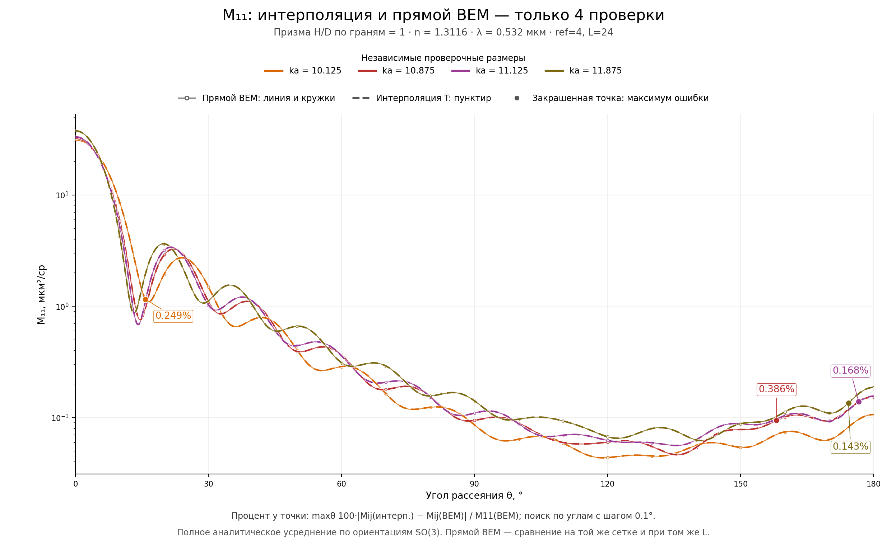

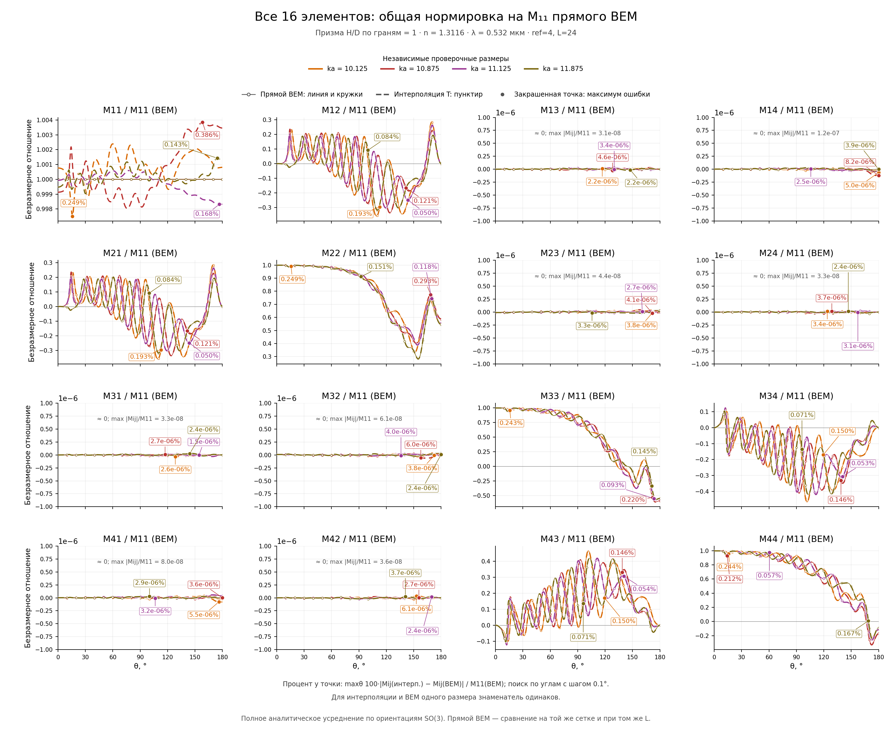

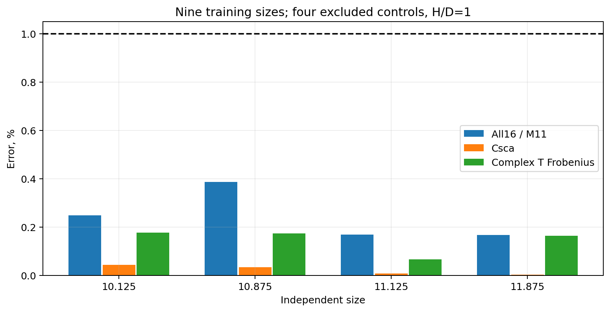

Контроллер `run_tmatrix_multisize.py` исторически настроен на эту призму
$H/D_f=1$. Он наследует абсолютный срок и нижний сеточный контроль из
существующей серии через `deadline-from`; время проверки и построения
опор входит в общий бюджет. Это не универсальная команда для любого
аспекта. Для столбика 10/7 сначала готовят и проверяют собственную семью
через `build_fmm_tmatrix.py`, а не подменяют геометрию старой модели.

## Применение к собственным опорным T

Для уже подготовленного нижнего сеточного контроля и ещё действующего
срока исходной серии можно подготовить исторический контроллер:

```bash
python3 scripts/run_tmatrix_multisize.py \
  --out runs/multisize_10_12 \
  --deadline-from runs/size_series/plan.json \
  --ka-min 10 --ka-max 12 --order 24 --ref 4 \
  --ri 1.3116 --wavelength-um 0.532 --prepare-only
```

Требуются существующие `plan.json` и `ka10_assessment.json` с успешным
нижним контролем; пустой план или истёкший срок не подходят. Эта команда
использует аспект 1. После проверки плана убирают `prepare-only`.

Для другой собственной семьи можно использовать API. Ниже предполагаются
**заранее завершённые** девять опор и отдельная контрольная T, сохранённые
по указанной схеме имён. В release эти большие файлы не вложены.

```python
import json
import sys
from pathlib import Path
import numpy as np
sys.path.insert(0, "scripts")
from tmatrix_size_interpolation import fit_aaa, validate_family
from tmatrix_so3_mstm import analytic_mueller_tmatrix

base = Path("runs/family")
nodes = np.linspace(10, 12, 9)
folders = [base / f"ka{x:.3f}" for x in nodes]
reports = [json.loads((p / "summary.json").read_text()) for p in folders]
assert all(r["complete"] for r in reports)
validate_family([r["parameters"] for r in reports])
samples = [np.load(p / "tmatrix.npy", mmap_mode="r") for p in folders]
model, diagnostics = fit_aaa(nodes, samples, tolerance=1e-6)

# Эта точка не входит в обучение; прямой контроль считается отдельно.
x = 10.125
control = base / f"ka{x:.3f}"
report = json.loads((control / "summary.json").read_text())
assert report["complete"]
validate_family([reports[0]["parameters"], report["parameters"]])
truth = np.load(control / "tmatrix.npy", mmap_mode="r")
predicted = model.evaluate(x)
L = reports[0]["parameters"]["order"]
theta = np.linspace(0, 180, 1801)
kwargs = dict(precision="fp64", threads=2, cyclic_order=6)
reference, _ = analytic_mueller_tmatrix(truth, L, theta, **kwargs)
candidate, _ = analytic_mueller_tmatrix(predicted, L, theta, **kwargs)
error = np.max(np.abs(candidate-reference) / reference[:, 0, 0, None, None])
print("All16 / M11 error, %:", 100*error)
```

`training_tolerance_met` в `diagnostics` относится только к обучающим T.
Перед выпуском плотной сетки нужны **несколько** исключённых контрольных
размеров, проверки сечений и поверхности. `cyclic_order=6` допустим только
при проверенной C6-симметрии. Для произвольной формы используют 1.
Оценка в новых точках использует барицентрические коэффициенты по размеру;
она не переносит токи между новыми узлами поверхностной сетки.

## Какой шаг размера действительно проверен

Независимый опыт при ka=3 и 6, $m=1.3116$, $H/D_f=10/7$, ref2:

| Метод | Шаг опор Δka | Максимум при ka≈3 | Максимум при ka≈6 |
|:---|---:|---:|---:|
| Линейный | 0.25 | 20.47% | 20.56% |
| Кубический | 0.25 | 6.05% | 6.39% |
| Рациональный AAA, 9 опор | 0.25 | **0.503%** | **0.580%** |
| Кубический | 0.125 | **0.275%** | **0.348%** |
| AAA, 9 опор | 0.125 | **0.00278%** | **0.00302%** |
| Линейный, две опоры | 0.05 | **0.581%** | **0.820%** |

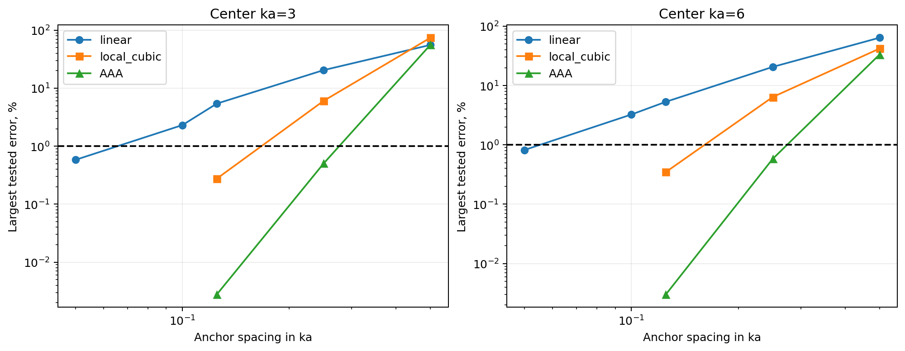

При шаге 0.5 изученные методы не прошли: ошибки порядка 33–74%.
Фазовое/Hankel-масштабирование, преобразования Cayley и проверенные модели
Loewner не подтвердили безопасный большой интервал. Успех AAA на ka=3/6
не переносится автоматически на ka=40, резонансы или поглощение.
Для соседей ka=40 в опубликованном наборе нет законченного независимого
сертификата интерполяции; частичный новый расчёт таким сертификатом не является.

## Производные, Taylor, Padé и смена центра

Из $A(k)x(k)=b(k)$ следует рекурсия по производным: один оператор в центре
и правые части из производных ядра/падающего поля. Это может заменить
несколько независимых сборок, но требует решений для моментов и контроля
радиуса применимости. Прямые производные ядра и физического входа доступны
как экспериментальные средства.

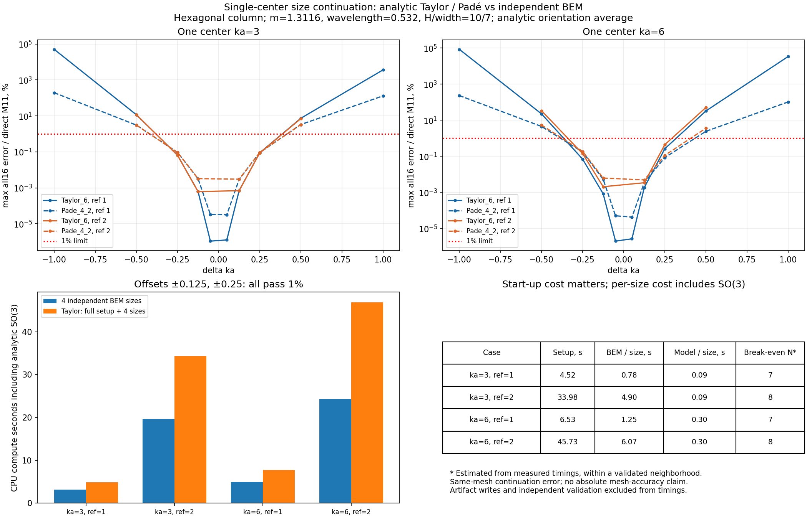

На малой CPU-модели центр ka=3, Taylor порядка 4, радиус 0.25: шесть
контролей, максимум 0.2781%. После переноса центра на 3.25 продолжение
Taylor ещё на 0.25 дало **1.1132%**, то есть провал. Padé(2,1) с радиусом
0.125 прошёл шесть свежих контролей с максимумом 0.1604%.

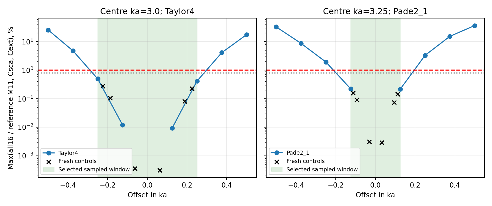

Это не измерение полной большой GPU T. Нативные FFT/FMM моменты и их
полная стоимость остаются отдельными проверками плана ускорения.

# Невязка и итоговая матрица Мюллера

Невязка $\|Ax-b\|/\|b\|$ не равна ошибке Мюллера. При ka=40, ref4,
одном фиксированном осевом падении относительно более строгого контроля:

| Допуск | Максимальная ошибка Мюллера | Экономия времени данного теста |
|:---|---:|---:|
| 2e-6 | 0.0331% | базовый вариант |
| 1e-5 | 0.2354% | 13.0% |
| 3e-5 | 0.8705% | 19.3% |
| 5e-5 | 1.2096% | 22.5% |
| 1e-4 | 2.1090% | 27.0% |
| 1e-3 | 23.5454% | 43.3% |

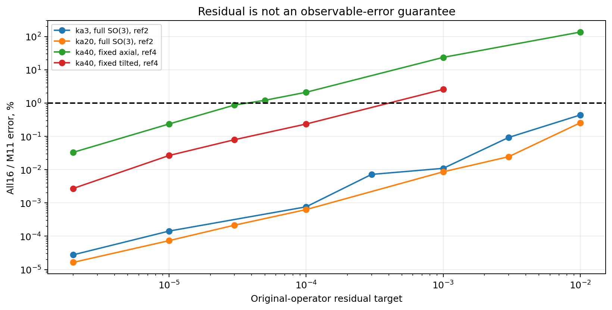

Для другого наклонного падения ошибка при 1e-3 была 2.576%. Малые полные
T на ref2 после усреднения гораздо менее чувствительны: ka=3/6/20 дали
около 0.0109/0.0248/0.0086% при 1e-3. Это не разрешение применять 1e-3
к большой T ka=40. Адаптивный допуск — опция с более строгими контрольными
пакетами и повторными решениями; полная тонкая проверка остаётся незавершённой
на дату снимка. Строгий исходный результат ka=40 использовал около 2e-6.

# Измеренное время и ресурсы ka=40

Машина исследования: RTX 3090 Ti 24 GiB, Ryzen 9 7950X (32 аппаратных
потока), около 61 GiB доступной системе RAM. Параметры: $m=1.3116$,
$\lambda=0.532$ мкм, $H/D_f=10/7$, ref6, **1 032 192 неизвестных**, L=64.
Завершены все **8448 столбцов**.

| Величина | Сохранённое измерение | Что входит |
|:---|---:|:---|
| Последний этап с возобновлением | 37 539.03 с = **10.43 ч** | После загрузки 2412 готовых столбцов |
| Аналитическое SO(3) | **34.70 с** | Уже готовая T |
| T на диске | 1 141 899 392 байт | NPY complex128, около 1.064 GiB |
| Максимальная строгая невязка | 1.994e-6 | Проверенные одиночные и закодированные RHS |
| Контроль нового направления поля | 1.5104e-5 | Отдельная проверка проекции |
| Csca / Cext | 7.43199 / 7.43512 | Принятые безразмерные сечения |

**10.43 часа — не время полного холодного построения.** Расчёт проходил
несколько продолжений; последняя сводка не содержит суммарное холодное
время всех этапов. Его нельзя восстановить простым умножением времени
пары или приписать алгоритму как измеренный итог.

В длительном текущем процессе ref6 измерялось примерно 21–23 GiB VRAM
и 35 GiB RAM; пик зависит от варианта и кэшей. Это наблюдение процесса,
а не жёсткая верхняя граница потребления.

## Какие ускорения измерены отдельно

| Опыт | Было → стало | Область применимости |
|:---|:---|:---|
| FFT граней, ka40/ref5, два настоящих RHS | worker 88.64→74.09 с | −16.41% времени worker |
| Тот же запуск целиком | 106.31→102.69 с | Выигрыш уменьшается из-за подготовки |
| CPU/GPU, ref4, два пакета | 57.89→51.96 с | −10.25% |
| CPU/GPU, ref5, два пакета | 271.17→267.75 с | −1.26%, ещё 14.38 GiB RAM |
| Другой CPU/GPU вариант ref5 | 271.17→280.37 с | **+3.39%, замедление** |

FFT используется на регулярных участках граней; углы, близкие взаимодействия
и нерегулярные части требуют поправок. Спектральное умножение само по себе
не устраняет итерации. Полезен предобуславливатель, приближающий физический
обратный оператор; его качество измеряется вместе со стоимостью применения.
Проверенные невыгодные варианты сохранены как отрицательные результаты.

# Сравнение BEM и MBS-fast при ka=40

Использована завершённая BEM T выше с аналитическим SO(3). MBS-fast:
$m=1.3116$, та же длина волны и объём, $H/D_v=1.2371791483$.
Новый бинарник со surface/shadow изменениями сравнивался в когерентном и
некогерентном режимах. В переносимом наборе записаны commit и SHA256 бинарника.

Условия нового MBS: 8 независимых Haar/Owen–Sobol перемешиваний по 4096
ориентаций, 32 азимутальных отсчёта, глубина 14, 222 угла рассеяния.
Это **фиксированный объём выборки**, не новый успешно сошедшийся fullauto
на 1% или 4%. Старые fullauto-запуски имеют свои отдельные статусы.

Общая величина — $k^2\,d\sigma/d\Omega$. В сравнении использован физический
масштаб 139.4878795 и перевод Stokes через диагональ $(1,1,-1,-1)$;
подгонки амплитуды под BEM нет. 95%-интервалы — поточечные, не совместная
гарантия всех углов/элементов. Они характеризуют статистику MBS, не точность
его физической модели.

| Сравнение с BEM | Когерентный MBS | Некогерентный MBS |
|:---|---:|---:|
| Взвешенная L2, все 16 элементов | 2.533% | 5.520% |
| Максимум абсолютного отличия / M11 | 43.54% | 59.09% |
| M11 вперёд, знаковое отличие | −1.005% | +3.761% |
| M11 назад, знаковое отличие | −43.54% | −29.67% |

Максимум когерентного варианта находится в M11 при 180°;
некогерентного — M44 около 177.76°. Малое интегральное отклонение не
означает поточечную сходимость в обратном направлении.

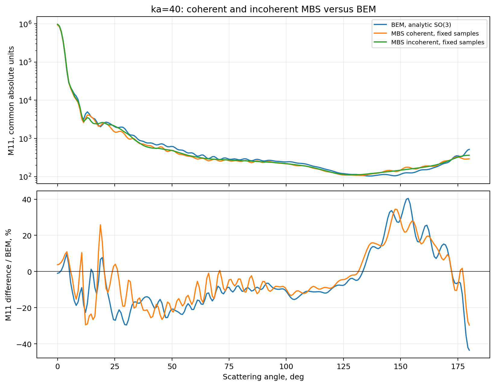

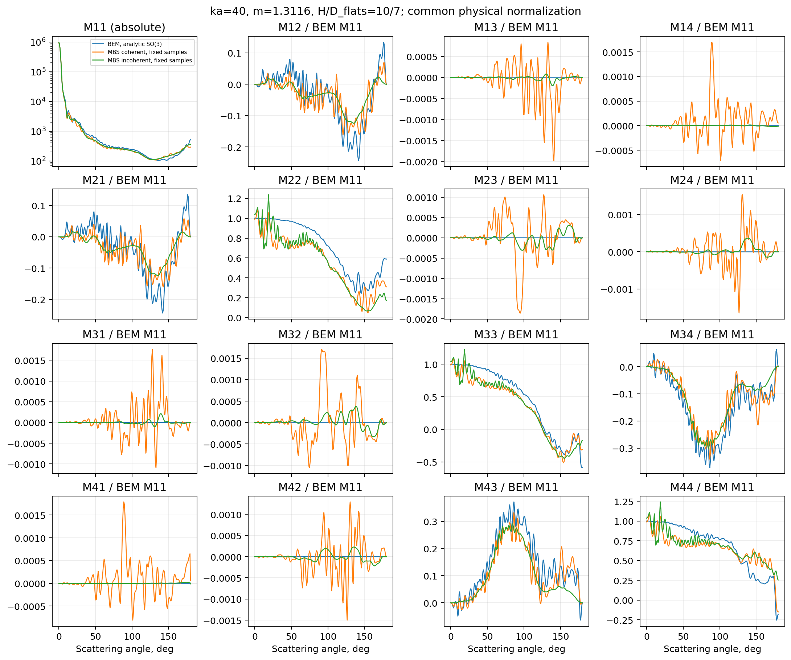

Весь новый пакет сравнений и контролей MBS занял 766.02 с. Он включает
несколько вариантов; это не время одной T или одного MBS-прогона.
BEM T была переиспользована. Прямое сравнение 766 с и 10.43 ч как времени
двух методов при равной точности было бы некорректным.

Поглощающий тест $m=1.3116+10i$ при ka=20 — отдельная задача проверки
Френеля/отражения; результаты вещественной частицы выше на неё не переносятся.
Экспериментальные инструменты `audit_mbs_fresnel.py` и
`absorbing_fixed_comparison.py` входят в код, но универсальное улучшение
MBS для поглощения не объявляется результатом этой BEM-версии.

No equal-accuracy speedup over ADDA is currently claimed.
Сопоставимое по точности ускорение BEM относительно ADDA не заявляется.
Построение полной T и численное усреднение заданного набора ориентаций
имеют разную стоимость и разные возможности повторного использования.

# Экспериментальные направления и воспроизводимость

[План ускорения](docs/acceleration_plan.md) содержит P1–P13 и условия
приёмки. Состояние в этой версии — снимок на 1 ноября 2026 г.; будущие
проверки в очереди не считаются выполненными результатами release.

| Направление | Состояние доказательств |
|:---|:---|
| P1 адаптивная невязка | Малые полные T проверены; большая тонкая проверка идёт |
| P2 recycling | Выигрыш на серии пакетов; полная T требует контроля |
| P3 пакетный FFT | Малый полный тест точен; выигрыша пока нет, тонкий тест ожидается |
| P4 mapped FFT | Подготовлено; рабочий GPU-контроль ожидается |
| P5 пакетный CPU FMM | Независимые CPU-проверки пройдены; совместный GPU-тест ожидается |
| P6 объединение подпространств | Малый полный T: +1.72% времени; распределение ранга проверяется |
| P7 адаптивный L | Усечения и ретроспективная взаимность проверены; новая достройка открыта |
| P8 SPAI | Изученный вариант медленнее на 10–21%, отклонён |
| P9 спектральный OSRC/MtE | Малый выигрыш подготовки; длинная серия ожидается |
| P10 краевые блоки | Изученный вариант медленнее, отклонён |
| P11 Taylor/Padé | Малые модели и перенос центра проверены; нативная большая модель открыта |
| P12 начальные токи/MBS/Ritz | Малые проверки; убедительного выигрыша рабочей T нет |
| P13 D6h-модель | Малые проверки; число действий с подготовкой не сократилось |

## Переносимые данные

`reference/v1.0.0/research/data.json` содержит сводки перечисленных серий;
`source_manifest.json` — исходные относительные пути, размеры и SHA256;
`mbs_ka40_all16.csv` — углы и все сравниваемые элементы.
Большие T, поверхностные токи, кэши и приватные рабочие каталоги не входят
в release. Исходные пути в manifest служат происхождением, а не обещанием
наличия каждого многогигабайтного расчёта в архиве.

Перестроить новые сводные графики и PDF из опубликованных данных:

```bash
python3 scripts/build_v1_research_assets.py
python3 scripts/build_manual.py
```

Для PDF дополнительно нужны Pandoc и XeLaTeX с DejaVu-шрифтами.
`MANUAL.md` — основной источник, `MANUAL.tex` генерируется из него.
Сборщик не запускает новых BEM-расчётов.

## Архивные растровые графики

Графики четырёх контрольных размеров, шести форм, Taylor и взаимности
сохранены из исходных исследований. Их происхождение и хеши зафиксированы.
Новые сводные графики воспроизводятся из JSON/CSV; старые растровые
изображения включены без перерисовки и без изменения исходных значений.

Полное старое руководство, таблицы прежних ориентационных исследований
и материалы сходимости остаются в репозитории. Их параметры и даты не
переписаны под текущий столбик. Для проверки программной версии используются
`tests/test_*.py`, native host checks и `scripts/release_audit.sh --gpu`.
Фактически выполненные release-проверки и исключения перечисляются
в отчёте проверки, приложенном к GitHub release.
