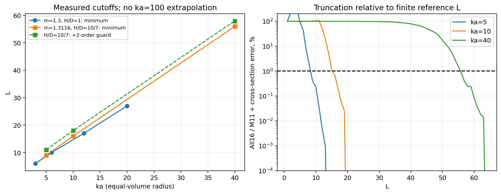
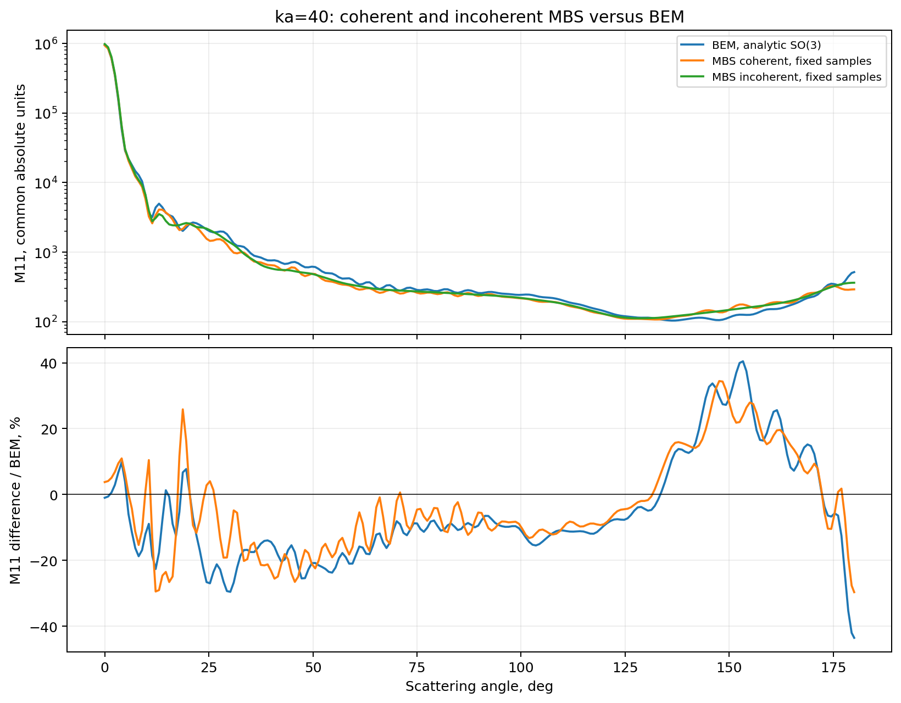

# BEM-CPP

**Electromagnetic scattering with surface BEM, T matrices and analytic orientation averaging.**

Current release: `1.0.0`. The CPU/GPU profiles below describe the development
branch, measured on 16–17 November 2026; they are not new release measurements.

[Русское руководство с графиками](MANUAL.md) · [PDF](MANUAL.pdf) ·
[Release notes](CHANGELOG.md) · [Research data](reference/v1.0.0/research) ·
[Acceleration plan](docs/acceleration_plan.md) ·
[Checked FFT acceleration and general surface symmetries](docs/fft_symmetry_generalization.md)

BEM-CPP solves the Muller surface integral equation (or the experimental Dirac
transmission formulation), builds a vector spherical
wave T matrix, and analytically averages all particle orientations over SO(3).
For a fixed shape and material, independently validated local models of T(ka)
can produce many nearby sizes without solving BEM at every requested size.

Version 1 makes this workflow the main documented interface. It includes
FMM/face FFT acceleration, C6 and mirror symmetry, sector GMRES, recycling,
checkpoint continuation, and optional CPU/GPU overlap. Experimental features
remain opt-in; version 1 does not certify 1% accuracy for arbitrary particles.

## Быстрые варианты на CPU и GPU

**Для CPU на ka=10–20 используйте Дирака с плотным SIMD-оператором и
симметрией; на ka=30–40 — Дирака/FMM с предобуславливателем `full-p1`.
Для больших T-матриц на GPU основной вариант — Мюллер с FMM/сжатым FFT.**
Это выбор среди проверенных конфигураций нашего кода. Полного сравнения
времени T-матрицы всех методов на каждом размере пока нет.

Измерения: Ryzen 9 7950X, 16 физических ядер / 32 потока, RTX 3090 Ti 24 GiB,
около 62 GiB RAM. Частица — правильный шестигранный столбик SciIce,
`m=1.3116`, `lambda=0.532 µm`, `ka` по равнообъёмному радиусу,
**H/ширина между противоположными гранями = 1.6495721976846451**.
Это соответствует H/диаметру по вершинам = 10/7. Значение `--aspect 10/7`
означает другую геометрию.

### ka=10, 20, 30, 40: законченные короткие расчёты

Здесь время **четырёх независимых сферических мод**, включая подготовку
CPU-решателя, а не всей T-матрицы и не четырёх плоских ориентаций.
Моды `(p,l,m)`: `(0,2,-1)`, `(1,1,-1)`, `(0,ka,-1)`, `(1,ka-1,-1)`.
Пустая ячейка означает отсутствие сопоставимого измерения.

| ka | Дирак / CPU, дискретизация и профиль | Время, с | Пик RAM, GiB | Мюллер / GPU, те же 4 моды, с |
|---:|---|---:|---:|---:|
| 10 | P3/ref2, dense SIMD, орбиты симметрии | 4.98 | 0.84 | — |
| 20 | P3/ref3, dense SIMD, орбиты симметрии | 45.31 | 12.04 | — |
| 30 | P3/ref4, FMM + полный P1, до сокращения хранения | 523.75 | 25.00 | — |
| 40 | P3/ref4, FMM + сокращённый полный P1 | 439.26 | 21.02 | 344.13, BDM1/ref6 |

На ka=40 CPU-время — сумма холодного решения 438.45 с и отдельно измеренной
проекции на L=65, 0.81 с. GPU-время использует уже готовые FFT-коэффициенты.
В этих условиях GPU быстрее в **1.28 раза**; это не отношение холодных полных
T-расчётов. Историческая подготовка FFT занимала ещё 212.02 с; сумма 556.15 с
получена из разных запусков и не является новым полным замером.
Уменьшение времени между ka=30 и 40 объясняется сменой реализации, а не
убыванием сложности с размером.

Невязка Дирака ≤1e-8, Мюллера в парном ka40-тесте ≤2e-6. Проверка полей
включала 181 угол одного меридиана. Максимальное расхождение интенсивности
на ka10/20/40 — 0.079% / 0.606% / 0.397%; на ka10 это проверка ref2/ref3,
на ka20/40 — сравнение с Мюллером. На ka30 исходные 1.182% смешивали ошибку
проекции и метода: при одинаковом L=50 расхождение 0.401%, собственная
ошибка проекции Дирака падает с 1.070% при L50 до 0.00612% при L60.
Это проверки выбранных мод, не сертификат 1% для всех элементов усреднённой
матрицы Мюллера. Сохранены [числа и границы сравнения](reference/performance_20261117/README.md)
и [графики CPU](reference/performance_20261117/cpu_dirac_comparison.pdf).

### ka=80/ref7: пока только действия операторов

| Вариант | Неизвестных на полной поверхности | Рабочее действие, с |
|---|---:|---:|
| Мюллер / GPU, BDM1, сжатый FFT | 4 552 704 | 1.70–1.75 |
| Дирак / GPU, P3, скалярные FMM-каналы | 60 702 720 | 29.19 |
| Дирак / CPU, P3, FMM, 32 потока | 60 702 720 | 62.05 |

Для Дирака GPU ускоряет рабочее действие примерно в **2.13 раза** относительно
последнего CPU-замера. Строгий контроль остаётся на CPU; время полного
решения так масштабировать нельзя. GPU-планы занимают 19.96 GiB; пик RAM
сравнительного процесса — 37.03 GiB, включая CPU-эталон и рабочие массивы.
Для Мюллера полный строгий контроль занимает **51.87 с**, а первые 128
итераций — в среднем 1.979 с/итерацию с накладными расходами.

**Полная T-матрица ka80 не завершена, её время ещё не измерено.**
Для планирования Мюллера: при L=120…137, среднем 100–150 итераций и двух
строгих проверках на правую часть основной цикл даёт **9–16 суток**.
Это условная оценка; подготовка, дополнительные проверки, проекция,
сборка T и SO(3) добавляются отдельно. Число итераций и достаточность L/ref
для 1% ещё не установлены. [Формула и исходные замеры](reference/performance_20261117/README.md#ka80).

### Чем отличаются Мюллер и Дирак

| | Мюллер | Дирак |
|---|---|---|
| Граничные неизвестные | Электрический и магнитный тангенциальные токи | Восьмикомпонентная граничная плотность в формулировке Дирака |
| Дискретизация острогранного столбика | H(div)-совместимый BDM1 | Панельные полиномы P3 |
| Основной быстрый путь | GPU, секторный GMRES, FMM/сжатый FFT | CPU SIMD на малых сетках; CPU-FMM + полный P1 на средних |
| Точность | Рабочий приближённый оператор + строгий контроль остатка | FMM 1e-8 + полный контроль при FMM 1e-12; остаток ≤1e-8 |
| T и усреднение | Векторные сферические моды и аналитическое SO(3) | Те же входные/выходные моды и аналитическое SO(3) |

На одной замкнутой треугольной сетке из N панелей BDM1 здесь даёт `6N`
неизвестных, P3-Дирак — `8 × 10N = 80N`, в **13⅓ раза больше**.
Это свойство выбранных базисов, не обязательная цена формулировки Дирака.
P3 допускает более грубую сетку: в ka40-сравнении использованы ref4 против
ref6. Одинаковый `ref` не означает одинаковую точность. На ka80 более грубый
P3 ещё надо проверять; полный P1-предобуславливатель для P3/ref7 в 62 GiB
не помещается. Сравнение только времени одного действия не определяет
победителя по времени решения.

Профиль `full-p1` сохраняет связь старших и младших коэффициентов, но убирает
из хранения избыточную низкую часть поправки. На ka40 подготовка поправки
ускорилась 421.28 → 186.57 с, холодное решение четырёх мод — 674.37 →
438.45 с (**1.54×**), пик RAM — 25.50 → 21.02 GiB. Итерации 11/11/11/12
сохранились. Последующий выбор FMM-пакета 2 вместо 1 дал 12.36 → 10.92 с
на четырёх рабочих действиях; новое холодное время ему не приписывается.

## Сборка быстрых вариантов

Linux, Python 3.10+, GCC с OpenMP, gfortran, BLAS/LAPACK; для GPU — совместимые
CUDA и host-компилятор. Используйте отдельное Python-окружение:

```bash
git clone -b experiment/analytic-alpha https://github.com/KirillSalnikov/BEM-CPP.git
cd BEM-CPP
python3 -m venv .venv
source .venv/bin/activate
python3 -m pip install -r requirements-analysis.txt
# Быстрая проекция дальнего поля Дирака; проверено с FINUFFT 2.5.1:
python3 -m pip install 'finufft>=2.4,<3'
```

**CPU, Дирак:** CUDA не требуется. `--fast-complex` включает проверенное
ограниченное комплексное умножение; строгая FP64-проверка сохраняется.
FMM-сборка загружает закреплённый FMM3D commit
`cad293ae9b8ae1218dd8319d459ffcc5f1412875` и накладывает проверяемые по хешам
изменения ближнего ядра и OpenMP-расписания.

```bash
python3 benchmarks/clifford_dielectric_20261115/build.py \
  --fast-complex --output build/libdirac.so
# Для ka30/40 и backend=fmm-sector:
python3 benchmarks/clifford_fmm_20261115/build.py --fmm-only --jobs 8
make bin/tmatrix_so3_mstm
```

`-march=native` выбирает инструкции процессора сборки. На нашем 7950X
подтверждено применение AVX2/AVX-512; такой бинарник не следует переносить
на более старый CPU. `--fmm-only` сохраняет выбранную сборку `libdirac.so`.

**GPU, Мюллер:** пример для RTX 3090 Ti, CUDA в `/usr`, GCC 12.
Замените `CUDA_HOME`, компилятор и архитектуру под свою систему.
Для CPU-FFT нужен `libfftw3-double3`; нестандартный путь задаётся
`BEM_CPU_FFTW_LIBRARY`.

```bash
python3 -m pip install -r requirements-fft.txt
make muller-fp32 bin/muller_tmatrix_fmm_server \
  CXX=g++-12 CUDA_HOME=/usr ARCH=-arch=sm_86 -j2
make bin/tmatrix_so3_mstm bin/tmatrix_so3_mstm_fp32
```

**Опциональный GPU-Дирак:** после CPU-сборки выполните
`python3 benchmarks/dirac_gpu_fmm_20261116/build.py`.
Этот экспериментальный скрипт рассчитан на `/usr/bin/nvcc`, GCC 12 и sm86.
В экспертном `benchmarks/clifford_dielectric_20261115/tmatrix.py` выбираются
`--backend fmm-sector --fmm-working-device cuda --gpu-fmm-depth 7`.
Рабочее действие использует GPU, строгие проверки — CPU. Выигрыш полного
T-решения этим вариантом пока не установлен.

## Запуск выбранных профилей

Простой интерфейс: `./bem wizard` или `./bem methods`. `--dry-run`
показывает параметры и команду без расчёта; автоматически выбранные ref/L
являются стартовой оценкой. Для CPU-измерений использовались 32 OpenMP-потока
и 16 BLAS-потоков только внутри LU; вне LU — один BLAS-поток.

```bash
export OMP_NUM_THREADS=32
export OPENBLAS_NUM_THREADS=1

# CPU: dense SIMD, ka20 (для ka10: --ka 10 --ref 2 и подходящий L).
./bem solve --method dirac --task average --shape prism \
  --ka 20 --ref 3 --L 40 --backend dense --threads 32 --ram-gib 48 \
  --aspect 1.6495721976846451 --index 1.3116 --wavelength .532 \
  --symmetry d6h --tol 1e-8 --out runs/dirac_ka20

# CPU: сокращённый полный P1. Для ka30: --ka 30 --ref 4 --L 60.
./bem solve --method dirac --task average --shape prism \
  --ka 40 --ref 4 --L 65 --backend fmm-sector \
  --dirac-preconditioner full-p1 --threads 32 --ram-gib 48 \
  --aspect 1.6495721976846451 --index 1.3116 --wavelength .532 \
  --symmetry d6h --tol 1e-8 --out runs/dirac_ka40

# GPU: Мюллер/FMM; не требует заранее рассчитанных FFT-факторов.
./bem solve --method muller --task average --shape prism \
  --ka 40 --ref 6 --L 65 --threads 16 \
  --aspect 1.6495721976846451 --index 1.3116 --wavelength .532 \
  --symmetry d6h --tol 2e-6 --out runs/muller_ka40
```

Это команды полной T и её аналитического усреднения; времена четырёх мод
из таблицы к ним не относятся. `--task tmatrix` сохраняет T без усреднения,
`--task fixed --orientation ALPHA BETA GAMMA` считает обе поляризации одной
ориентации (ZYZ, градусы). `--symmetry auto` определяет доступную симметрию;
`none|c6|c6v|d6h` задаёт её явно с проверкой геометрии.
`./bem continue runs/dirac_ka40` продолжает сохранённый расчёт.

Для измеренного **сжатого FFT** Мюллера нужен отдельно подготовленный и
проверенный набор коэффициентов. Перед командой задайте
`BEM_TMATRIX_COMPRESSED_FFT_CASE=/path/to/validated_fft_case`.
Большие коэффициенты не поставляются с репозиторием; подготовка пока является
исследовательским процессом, а не автоматической частью `bem solve`.
Геометрия, ref, ka и материал должны совпадать с манифестом набора;
FFT-коэффициенты ka40 нельзя использовать для ka80.
См. [сжатие, симметрия и проверки FFT](docs/fft_symmetry_generalization.md).
Без этой переменной работает обычный FMM, и FFT-времена из таблицы ему
не приписываются.

Профиль `full-p1` явно включает пакет 4 RHS, FMM-пакет 2, каналы 8/4,
FP32-хранение поправки с FP64-применением и LU до 16 потоков. `auto` выбирает
более экономный предобуславливатель при нехватке RAM и не обещает тот же
темп. Новое удаление точных нулевых хвостов FFT и нормировка базиса перед
сжатием остаются экспериментальными; производственные настройки сами
не меняются до численных GPU-проверок.

## Start here

The [manual](MANUAL.md) explains conventions, commands, error metrics, memory,
checkpoints and the limits of every published comparison. The primary method
uses P2 for smooth surfaces and H(div)-compatible BDM1 for sharp particles.
The legacy PMCHWT/RWG path is separate.

The unified interface selects **Muller**, experimental CPU **Dirac**, or legacy
**PMCHWT** and records physical parameters, numerical settings and resource limits:

```bash
./bem wizard
./bem methods
./bem solve --method muller --task average --shape prism \
  --ka 3 --index 1.3116 --wavelength .532 --symmetry auto --out runs/example
./bem solve --method dirac --task average --ka 20 --ram-gib 40 --dry-run
./bem continue runs/example
```

`--task fixed` solves both polarizations at `--orientation ALPHA BETA GAMMA`
(ZYZ degrees); `tmatrix` saves T; `average` saves T and its analytic SO(3)
average. `--index` accepts absorption, e.g. `1.3116+0.1i`. Choose `--ka` or
physical `--radius` in micrometres. `--symmetry none|c6|c6v|d6h` overrides the
automatic policy, with geometry checks. The initial ref/L selection does **not**
certify 1% accuracy; mesh and angular convergence remain separate controls.
Dirac currently supports sphere/prism; PMCHWT exposes fixed incidence only.
See the first sections of the [manual](MANUAL.md) for outputs, memory, building
and supported combinations. The older `bem average` command uses numerical
Euler quadrature; analytical averaging is `bem solve --task average`.

Build on Linux with a compatible CUDA/GCC toolchain, gfortran and BLAS/LAPACK.
CPU FFT also needs the double-precision FFTW runtime (`libfftw3-double3` on
Ubuntu); `BEM_CPU_FFTW_LIBRARY` can select a non-system installation:

```bash
python3 -m pip install -r requirements-analysis.txt
make muller-fp32 CXX=g++-12 CUDA_HOME=/usr -j2
make bin/muller_tmatrix_fmm_server CXX=g++-12 CUDA_HOME=/usr -j2
make bin/tmatrix_so3_mstm bin/tmatrix_so3_mstm_fp32
```

Small prism T matrix and analytic orientation average:

```bash
OMP_NUM_THREADS=2 OPENBLAS_NUM_THREADS=1 \
python3 scripts/build_fmm_tmatrix.py \
  --shape prism --ref 2 --ka 3 --ri 1.3116 \
  --prism-aspect 1.4285714285714286 --wavelength 0.532 \
  --order 10 --tol 2e-6 --max-iters 1000 \
  --c6-pack --mirror-pack --so3-precision fp64 --ntheta 181 \
  --out runs/example_ka3
```

T-matrix modes require Python 3.10+ and SciPy 1.15+ with
[`sph_harm_y`](https://docs.scipy.org/doc/scipy-1.15.0/reference/generated/scipy.special.sph_harm_y.html).
The legacy `sph_harm` fallback is rejected because it loses near-pole accuracy.
CI uses the validated NumPy 2.4.2 / SciPy 1.17.0 combination.

All seven MBS-fast particle types are available through `--particle TYPE ...`
or `--particle-file FILE`, with measured mesh symmetries and compatible solver
accelerations. See [particle parameters, symmetry and validation](docs/mbs_particle_shapes.md).

This is a demonstration, not a mesh-convergence certificate. Check
`summary.json` for completion and validation before using the result.
`ntheta` samples scattering angle; analytic averaging uses zero Euler
quadrature nodes. A complete T can be re-averaged without new BEM solves.

For a single fixed incidence, the existing launcher remains available:

```bash
./bem run --shape prism --ka 25 --ri 1.3
```

See [quality profiles](docs/quality_profiles.md) and the
[archived operational manual](docs/legacy_fixed_orientation_manual.md).

## Published research, with its scope

| Study | Recorded result | Qualification |
|---|---|---|
| Complete ka=40 T | 8448 columns, L=64, 1,032,192 unknowns | m=1.3116, H/width across flats=10/7 |
| ka=40 timing | Final resumed segment 10.43 h; analytic SO(3) 34.70 s | 2412 columns already existed; not cold total time |
| ka=40 order reduction | Guarded L=58 differs by 0.2408% from L=64 | Does not test modes above 64 or mesh error |
| Multisize ka=10…12 | 201 evaluations in 88.30 s; four independent holdouts ≤0.3856% | H/width=1; excludes direct training/control solves |
| Shape study | Six cases, ka=2/5, aspects 0.2/1/5 | Flat ka=5 mesh failed the 1% criterion |
| Coherent MBS-fast, ka=40 | Weighted all-element L2 difference 2.533% | Maximum angular difference/M11 is 43.54% |

Unless explicitly stated otherwise, angular error means
`max(theta,i,j) abs(delta Mij)/M11_reference`, not relative error in each weak
element. Mesh, T truncation, solver tolerance and interpolation require
separate controls. The multisize interval above is not a validated interval
around ka=40; ka=100 has not been completed.





The manual includes the all-16-element comparison, all six shape plots,
interpolation holdouts and maxima, tolerance sensitivity, local Taylor/Padé
models, and reciprocal block-extension tests. Portable summaries, source
hashes and Mueller CSV data are in [reference/v1.0.0/research](reference/v1.0.0/research).
Large T matrices, surface currents and machine-local operator caches are not
included in the release.

No equal-accuracy speedup over ADDA is currently claimed.

## Validation and documentation

```bash
scripts/release_audit.sh --host
# On an idle compatible GPU, from an isolated checkout:
scripts/release_audit.sh --gpu
examples/run_small_sphere_mie_check.sh
```

The [release reference](reference/v1.0.0/small_sphere.json) identifies the
actual reference measurement and its provenance. The [release audit report](reference/v1.0.0/validation/report.json)
states which checks were run for version 1 and any unavailable checks.
Historical numerical results are not relabelled as newly measured ones.

Regenerate summary plots and the manual using NumPy, Matplotlib, Pandoc and
XeLaTeX (DejaVu fonts):

```bash
python3 scripts/build_v1_research_assets.py
python3 scripts/build_manual.py
```

`MANUAL.md` is the source for `MANUAL.tex` and `MANUAL.pdf`.
See [CONTRIBUTING](CONTRIBUTING.md), [release checklist](docs/RELEASE_CHECKLIST.md),
[MIT license](LICENSE), [NOTICE](NOTICE), and [CITATION.cff](CITATION.cff).
