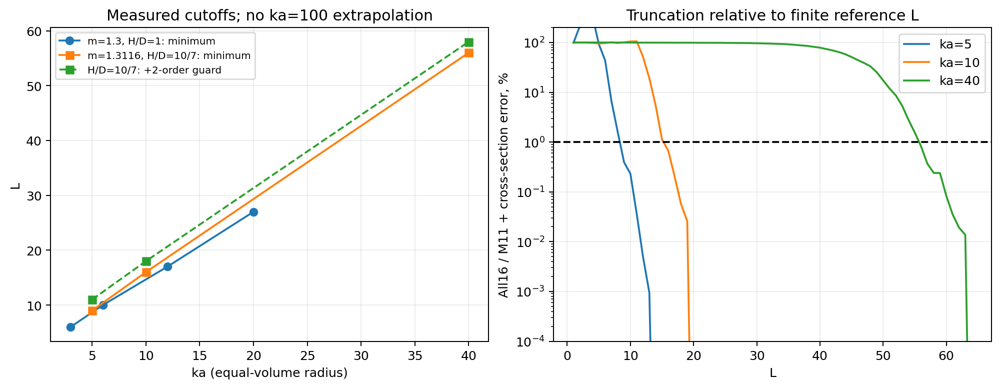
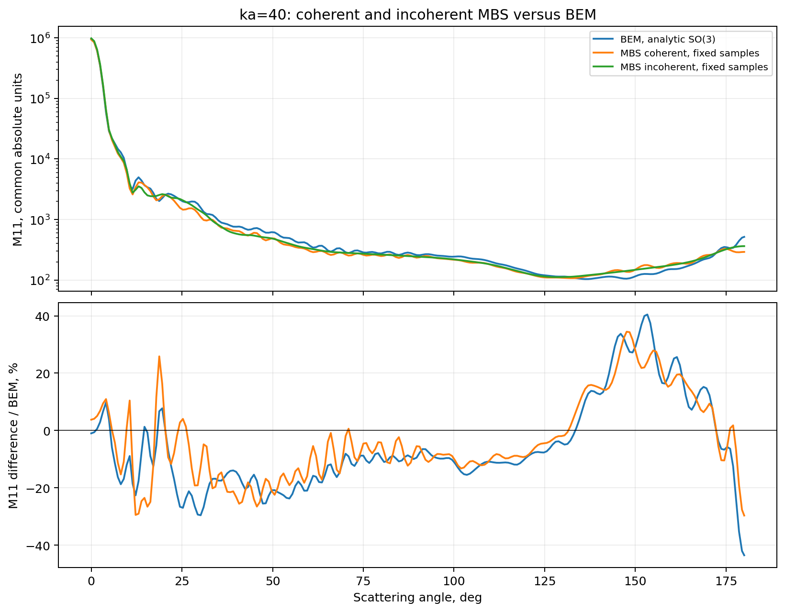

# BEM-CPP

**Electromagnetic scattering with surface BEM, T matrices and analytic orientation averaging.**

Current release: `1.0.0`

[Русское руководство с графиками](MANUAL.md) · [PDF](MANUAL.pdf) ·
[Release notes](CHANGELOG.md) · [Research data](reference/v1.0.0/research) ·
[Acceleration plan](docs/acceleration_plan.md)

BEM-CPP solves the Muller surface integral equation, builds a vector spherical
wave T matrix, and analytically averages all particle orientations over SO(3).
For a fixed shape and material, independently validated local models of T(ka)
can produce many nearby sizes without solving BEM at every requested size.

Version 1 makes this workflow the main documented interface. It includes
FMM/face FFT acceleration, C6 and mirror symmetry, sector GMRES, recycling,
checkpoint continuation, and optional CPU/GPU overlap. Experimental features
remain opt-in; version 1 does not certify 1% accuracy for arbitrary particles.

## Start here

The [manual](MANUAL.md) explains conventions, commands, error metrics, memory,
checkpoints and the limits of every published comparison. The primary method
uses P2 for smooth surfaces and H(div)-compatible BDM1 for sharp particles.
The legacy PMCHWT/RWG path is separate.

Build on Linux with a compatible CUDA/GCC toolchain, gfortran and BLAS/LAPACK.
CPU FFT also needs the double-precision FFTW runtime (`libfftw3-double3` on
Ubuntu); `BEM_CPU_FFTW_LIBRARY` can select a non-system installation:

```bash
python3 -m pip install numpy scipy matplotlib psutil
make muller-fp32 CXX=g++-12 CUDA_HOME=/usr -j2
make bin/muller_tmatrix_fmm_server CXX=g++-12 CUDA_HOME=/usr -j2
make bin/tmatrix_so3_mstm bin/tmatrix_so3_mstm_fp32
```

Small prism T matrix and analytic orientation average:

```bash
OMP_NUM_THREADS=2 OPENBLAS_NUM_THREADS=1 \
python3 scripts/build_fmm_tmatrix.py \
  --shape prism --ref 2 --ka 3 --ri 1.3116 \
  --prism-aspect 1.4285714285714286 --wavelength 0.532 \
  --order 10 --tol 2e-6 --max-iters 1000 \
  --c6-pack --mirror-pack --so3-precision fp64 --ntheta 181 \
  --out runs/example_ka3
```

This is a demonstration, not a mesh-convergence certificate. Check
`summary.json` for completion and validation before using the result.
`ntheta` samples scattering angle; analytic averaging uses zero Euler
quadrature nodes. A complete T can be re-averaged without new BEM solves.

For a single fixed incidence, the existing launcher remains available:

```bash
./bem run --shape prism --ka 25 --ri 1.3
```

See [quality profiles](docs/quality_profiles.md) and the
[archived operational manual](docs/legacy_fixed_orientation_manual.md).

## Published research, with its scope

| Study | Recorded result | Qualification |
|---|---|---|
| Complete ka=40 T | 8448 columns, L=64, 1,032,192 unknowns | m=1.3116, H/width across flats=10/7 |
| ka=40 timing | Final resumed segment 10.43 h; analytic SO(3) 34.70 s | 2412 columns already existed; not cold total time |
| ka=40 order reduction | Guarded L=58 differs by 0.2408% from L=64 | Does not test modes above 64 or mesh error |
| Multisize ka=10…12 | 201 evaluations in 88.30 s; four independent holdouts ≤0.3856% | H/width=1; excludes direct training/control solves |
| Shape study | Six cases, ka=2/5, aspects 0.2/1/5 | Flat ka=5 mesh failed the 1% criterion |
| Coherent MBS-fast, ka=40 | Weighted all-element L2 difference 2.533% | Maximum angular difference/M11 is 43.54% |

Unless explicitly stated otherwise, angular error means
`max(theta,i,j) abs(delta Mij)/M11_reference`, not relative error in each weak
element. Mesh, T truncation, solver tolerance and interpolation require
separate controls. The multisize interval above is not a validated interval
around ka=40; ka=100 has not been completed.





The manual includes the all-16-element comparison, all six shape plots,
interpolation holdouts and maxima, tolerance sensitivity, local Taylor/Padé
models, and reciprocal block-extension tests. Portable summaries, source
hashes and Mueller CSV data are in [reference/v1.0.0/research](reference/v1.0.0/research).
Large T matrices, surface currents and machine-local operator caches are not
included in the release.

No equal-accuracy speedup over ADDA is currently claimed.

## Validation and documentation

```bash
scripts/release_audit.sh --host
# On an idle compatible GPU, from an isolated checkout:
scripts/release_audit.sh --gpu
examples/run_small_sphere_mie_check.sh
```

The [release reference](reference/v1.0.0/small_sphere.json) identifies the
actual reference measurement and its provenance. The [release audit report](reference/v1.0.0/validation/report.json)
states which checks were run for version 1 and any unavailable checks.
Historical numerical results are not relabelled as newly measured ones.

Regenerate summary plots and the manual using NumPy, Matplotlib, Pandoc and
XeLaTeX (DejaVu fonts):

```bash
python3 scripts/build_v1_research_assets.py
python3 scripts/build_manual.py
```

`MANUAL.md` is the source for `MANUAL.tex` and `MANUAL.pdf`.
See [CONTRIBUTING](CONTRIBUTING.md), [release checklist](docs/RELEASE_CHECKLIST.md),
[MIT license](LICENSE), [NOTICE](NOTICE), and [CITATION.cff](CITATION.cff).
