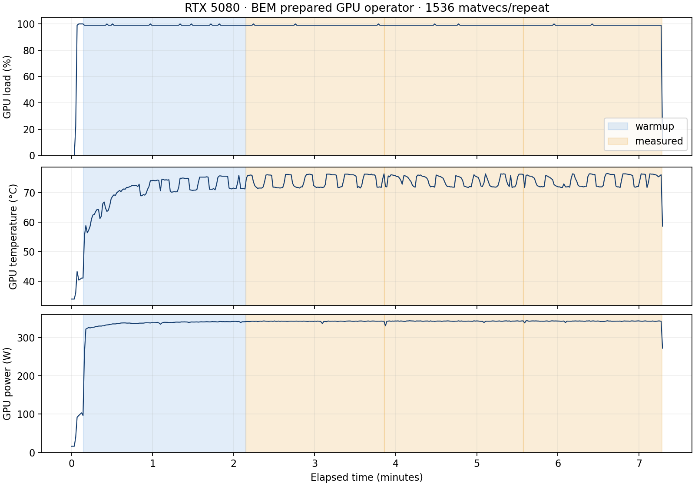

# RTX 5080: long prepared-operator test, 2026-11-03

The exclusive repeat passes all thermal-workload gates. Native source/build is
`23fe894`; wrapper/protocol is `5fbdc5f`. CUDA 13.4.3 (nvcc 13.4.92), native
sm_120, driver 621.01, Ryzen 9 9950X3D / WSL2. Exact binary, numerical source,
thermal-tool and runner hashes are retained in [results.json](results.json).

| Quantity | Measured value |
|---|---:|
| Unknowns / triangles | 258,048 / 43,008 |
| Matvecs per repeat | 1536 |
| Setup, excluded | 8.929 s |
| Continuous warmup, excluded | 120.021 s (1800 matvecs) |
| Three measured repeats | 102.675 / 102.704 / 102.708 s |
| Median / MAD | 102.704 / 0.00398 s |
| Total measured work | 308.087 s |
| Throughput | 14.9556 matvec/s |
| Median / tenth-percentile GPU load, each repeat | 99% / 99% |
| Median temperature in repeats | 73.7 / 74.3 / 74.7 °C |
| Highest observed measured temperature | 76.4 °C |
| Median board power | 342.6–342.9 W |
| Host/device relative difference | 1.400e-7 |
| Mixed/strict native path relative difference | 1.692e-6 |
| Repeat output error | <=1.405e-7 |
| Zero-input output | exactly zero |

The native operator remains on the GPU between calls. The CUDA-event span tracks
elapsed time including submission gaps; GPU utilization comes independently
from nvidia-smi. This result does not time a complete BEM solution, far-field
integration, or orientation average.

The entire [earlier series](discarded_overlap.json) is **invalidated for hardware
ranking**: an external MBS production worker started during its third interval.
No time from that series contributes to this score. The final run continuously
checked process identities and allowed only the benchmark and explicitly
stopped campaign PIDs. [The final lease receipt](restored_queue_lease.json)
confirms automatic resume of all three production processes.

The separate [full-solver controls](full_solver_correctness.json) passed all
181 angles / all 16 Mueller elements for fixed incidence and the small T-matrix
case. They ran on a shared GPU: **all their timings are excluded from ranking**.
[Cache control](cache_invalidation.json) proves old MBJ format v1 is rejected,
new v2 is written, then v2 is reused. See the
[Green audit](../../../../docs/GREEN_FUNCTION_AUDIT_20261103.md) for the actual
Hessian correction and its independently differentiated reference.

An additional strict surface-FMM diagnostic **does not pass**: combined/separate
and contracted/batched path differences are around 1.5e-6 and 2.6e-6 against
1e-7 internal thresholds. Direct-reference Hessian L2 is about 3.8e-5 and
gradient L2 about 2.4e-4; the volume case passes. Neither
[mixed-build diagnostics](gpu_derivative_diagnostic_mixed.json) nor
[six FP64-storage/cache override attempts](gpu_derivative_diagnostic_overrides.json)
resolve those strict surface-path discrepancies. No tolerance was relaxed.
The unchanged FMM/P2P sources and these failed checks are kept distinct from the
passing scalar-Green audit and benchmark regression gates. This is not a blanket
certificate of GPU accuracy at every size or geometry.

[Per-repeat CSV](summary.csv) · [raw score/telemetry](results.json)

